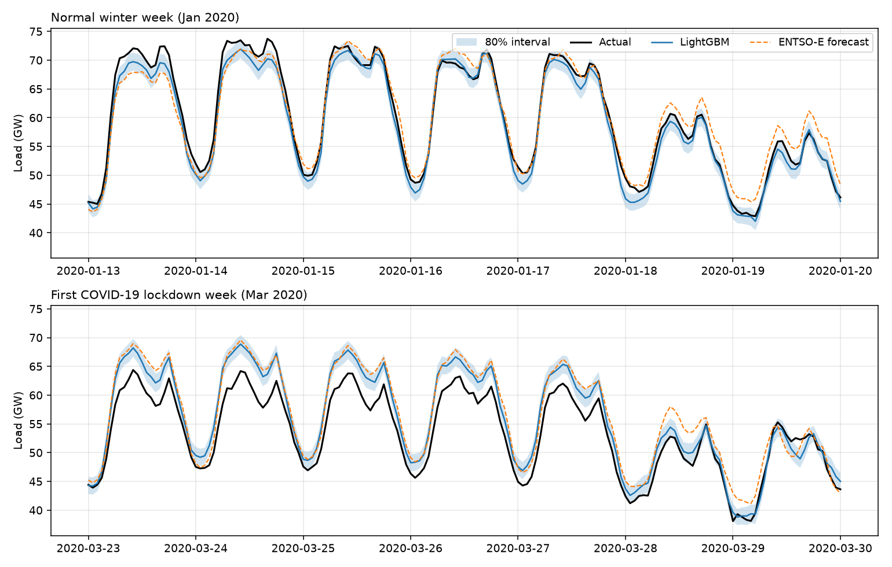
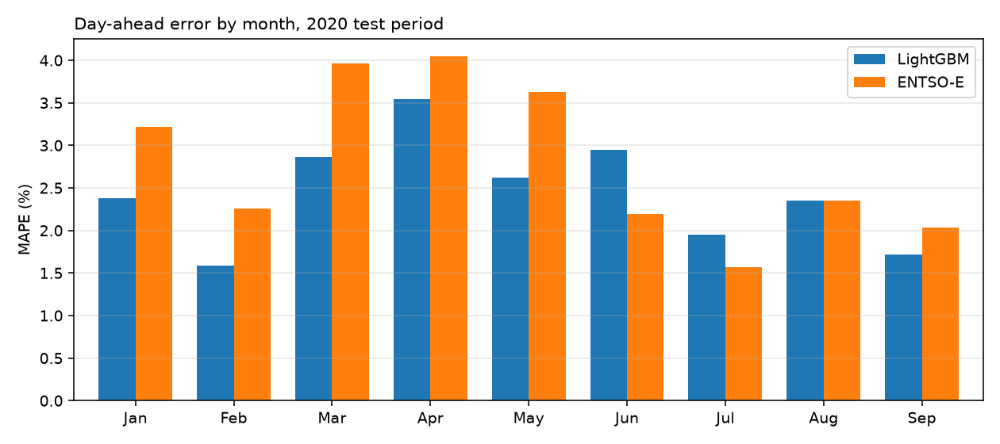
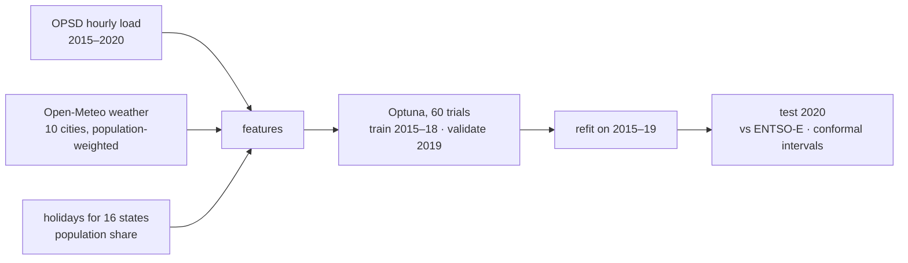
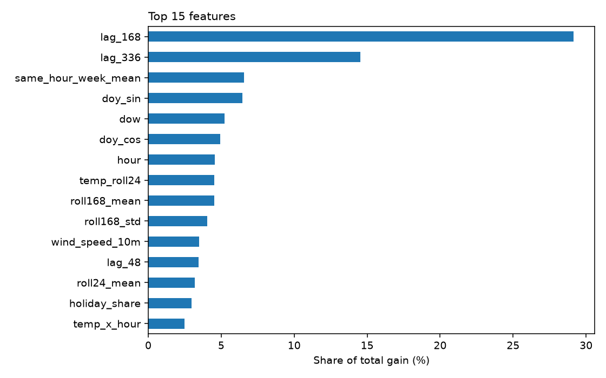

# ⚡ grid-load-forecast

[](https://github.com/hasnat23/grid-load-forecast/actions/workflows/ci.yml)
[](https://www.python.org/downloads/)
[](https://lightgbm.readthedocs.io/)
[](LICENSE)

**Day-ahead forecasting of Germany's hourly electricity demand**, using LightGBM tuned with Optuna, weather and holiday features,
and conformal prediction intervals. Benchmarked against the **official ENTSO-E day-ahead forecast** that the German
transmission system operators publish.



## 📊 Results (test period: Jan–Sep 2020, 6,576 hours, never seen during tuning)

| Model | MAPE % | MAE (MW) | RMSE (MW) |
|---|---:|---:|---:|
| **LightGBM (this repo)** | **2.44** | **1,257** | **1,648** |
| ENTSO-E / TSO day-ahead forecast | 2.81 | 1,459 | 1,892 |
| Seasonal naive (same hour last week) | 4.30 | 2,227 | 3,778 |
| LightGBM without weather features | 2.80 | 1,447 | 1,859 |
| LightGBM without holiday features | 3.03 | 1,514 | 2,479 |

- **13% lower error than the official forecast** (MAPE 2.44% vs 2.81%), and lower in 6 of 9 months (see below).
- **Holiday features matter most** in the ablation: German holidays differ by state, so the model uses the *share of the population*
  on holiday each day (16 state calendars, population-weighted) plus bridge-day and Christmas flags. Removing them raises RMSE by 50%.
- **Weather adds ~0.36 pp**: without it, the model only ties the TSO forecast.



The TSO forecast is better in June and July (and ties in August). A likely reason is summer behind-the-meter solar, which this model only
sees indirectly through radiation and cloud cover.

### Prediction intervals and the COVID-19 shock

80% intervals use **split-conformal calibration**: absolute errors of a model trained on 2015–2018, measured on 2019, with one width
per hour of day. They reach their target in normal months but undercover badly when demand shifted during the first lockdown:

| | Jan | Feb | **Mar** | **Apr** | May | Jun | Jul | Aug | Sep | All |
|---|---|---|---|---|---|---|---|---|---|---|
| Coverage of 80% interval | 66% | 81% | **58%** | **54%** | 70% | 60% | 81% | 70% | 85% | 69% |

Conformal guarantees assume tomorrow looks like the calibration year. March–April 2020 is a textbook violation; the plot above shows
both forecasts overshooting demand during the first lockdown week. (Quantile LightGBM models were tried first and were much worse:
34% coverage, because they overfit their training quantiles.)

## 🧱 Method



**Strictly day-ahead.** A forecast for day D is issued around noon on D-1, so load is only known up to ~36 h before the earliest
target hour. Every load feature uses **lags ≥ 48 h** (`lag_48`, `lag_168`, `lag_336`, rolling means/std of lagged load, same hour
on the last seven days). A unit test tampers with the most recent 48 hours of load and asserts that no feature changes.

| Group | Features |
|---|---|
| Load history | lags 48/72/96/168/336 h, 24 h and 168 h rolling stats, same-hour weekly mean |
| Calendar | local hour, weekday, month, day-of-year (sin/cos), weekend |
| Holidays | population share on holiday (today / yesterday / tomorrow), bridge days, Christmas period |
| Weather | temperature, humidity, cloud cover, radiation, wind; heating/cooling degree-hours; 24 h mean temperature; temperature × hour |



**Caveat:** weather features use *observed* weather as a stand-in for the forecast available at issue time, a common simplification
that makes the weather signal slightly optimistic. The no-weather ablation (2.80%) is a lower bound on what is achievable without it.

**Objective:** L1 (MAE) loss, which is robust to outliers and closer to MAPE than L2. Optuna's TPE sampler tunes learning rate, leaves,
min leaf size, feature/bagging fractions and L2 regularisation with early stopping on 2019. The refit uses 15% more rounds for the
larger training set.

## 🚀 Reproduce

```bash
git clone https://github.com/hasnat23/grid-load-forecast && cd grid-load-forecast
pip install -e ".[dev]"
python -m gridload.train --trials 60     # downloads data on first run (~130 MB + weather API)
```

Writes `results/metrics.json`, the three figures and `results/model.txt`. Expect an hour or more for 60 trials on a laptop CPU; `--trials 10` gives nearly the same accuracy in a fraction of the time.

**Data:** [Open Power System Data](https://data.open-power-system-data.org/time_series/2020-10-06) (ENTSO-E Transparency Platform,
actual load and TSO day-ahead forecast) · weather from the [Open-Meteo historical API](https://open-meteo.com/en/docs/historical-weather-api).

## 🧪 Tests

```bash
pytest   # no-lookahead check, holiday share (Christmas = 100%, Corpus Christi ≈ half), bridge days, metrics
```

## 📄 License

MIT © Muhammad Hasnat
